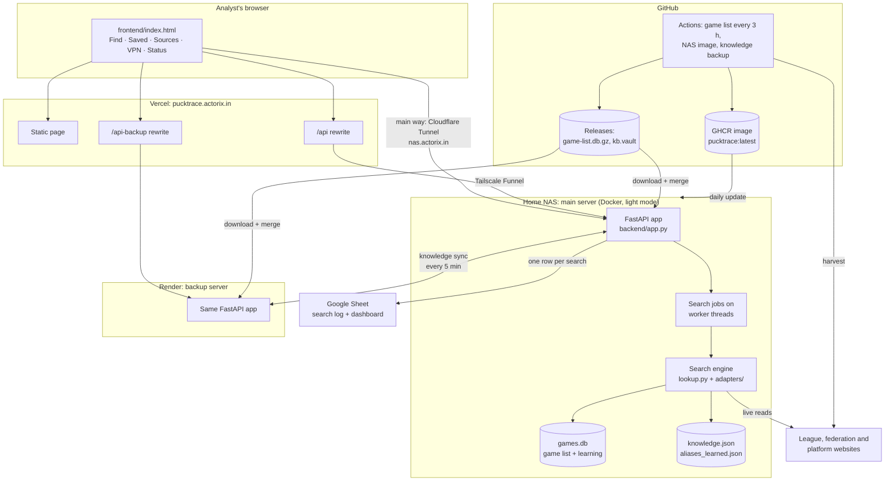
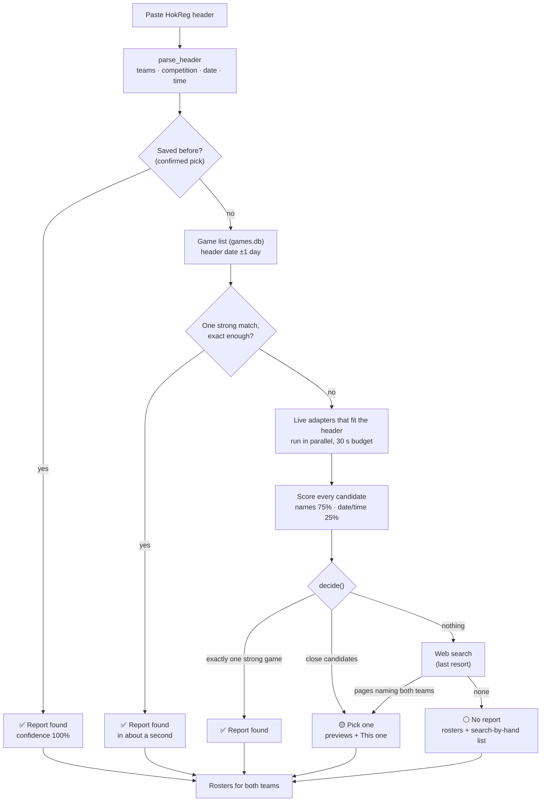

<div align="center">

# 🏒 PuckTrace

### Match-report and roster finder for the ice hockey RTT (Ready To Tag) workflow

*Formerly **RTT Finder**. Paste a HokReg match header, get the official match report link and both teams' rosters.*

[](https://www.python.org/)
[](https://fastapi.tiangolo.com/)
[](https://www.uvicorn.org/)
[](https://www.python-httpx.org/)
[](https://playwright.dev/python/)
[](https://www.sqlite.org/)
<br>
[](https://www.docker.com/)
[](https://vercel.com/)
[](https://www.cloudflare.com/products/tunnel/)
[](https://render.com/)
[](https://github.com/features/actions)
[](LICENSE)

[Overview](#-overview) • [Features](#-features) • [Architecture](#%EF%B8%8F-architecture) • [Installation](#-installation) • [How search works](#-how-the-search-engine-works) • [Sources](#-supported-data-sources) • [Commands](#-testing-and-useful-commands) • [License](#-license-and-ownership)

</div>

---

## 🎯 Overview

For every incoming ice hockey game, an RTT analyst has to find the **official match report** (game sheet, box score) on the league's own website, or, failing that, the **current rosters of both teams**, before the game can be tagged. Done by hand this takes a median of about **3 minutes per game** across tens of thousands of games a season.

**PuckTrace automates the search.** The analyst pastes the HokReg header:

```text
[2222393] County Grande Prairie WheatKings 0 - 0 Fort St. John Huskies | North West Junior Hockey League | 2026-09-27T05:00:00 | RL:8
```

and PuckTrace returns the report link, a preview to confirm it, and both rosters, usually within seconds.

### ✨ At a glance

| | |
|---|---|
| 🔎 **One paste, one answer** | Parses the header, finds the one game that matches both teams, the date and the start time |
| ⚡ **Answers from a pre-built game list** | A game list of the whole season (200,000+ games), rebuilt every 3 hours on GitHub, answers most headers in about a second |
| 🌍 **38 live source adapters** | League, federation and platform websites in North America and Europe are read directly when the list has no exact hit |
| 🎯 **Accuracy over coverage** | A guess is never shown as *Found*. Uncertain cases become a short *Pick one* list with previews |
| 👥 **Rosters for both teams** | Rosters from EliteProspects, GameSheet, HockeyTech, TimeToScore, club and league pages, each with a status badge |
| 🧠 **Learns as it is used** | Saved picks, learned team spellings and the weekly RTT Progress sheet make the next search faster and more accurate |
| 🛟 **Always-on with a backup** | Main server on a home NAS, automatic fallback to a backup server on Render with the same knowledge |

> **Scope.** PuckTrace is a search tool. It never writes to any sheet: the analyst still verifies the result against the video and records it in the Progress sheet. The season in scope is **2026-27**.

---

## 📋 Table of Contents

- [Features](#-features)
- [Application screens](#%EF%B8%8F-application-screens)
- [Tech stack](#%EF%B8%8F-tech-stack)
- [Architecture](#%EF%B8%8F-architecture)
- [Installation](#-installation)
- [How the search engine works](#-how-the-search-engine-works)
- [Team-name matching](#-team-name-matching)
- [Supported data sources](#-supported-data-sources)
- [Knowledge base, saved results and learning](#-knowledge-base-saved-results-and-learning)
- [Rosters](#-rosters)
- [Game list, harvesting and source health checks](#-game-list-harvesting-and-source-health-checks)
- [Deployment](#-deployment)
- [API reference](#-api-reference)
- [Configuration](#%EF%B8%8F-configuration)
- [Testing and useful commands](#-testing-and-useful-commands)
- [Project structure](#-project-structure)
- [Known limitations and operational notes](#%EF%B8%8F-known-limitations-and-operational-notes)
- [Roadmap](#%EF%B8%8F-roadmap)
- [License and ownership](#-license-and-ownership)

---

## ✨ Features

<table>
<tr>
<td width="50%" valign="top">

### 🔎 Search
- HokReg header parsing (match ID, teams, competition, date, Moscow-time start)
- Instant answers from the local game list and saved picks
- 38 live adapters, queried in parallel with time limits
- Verdicts: **Report found**, **Pick one**, **No report**
- "Why this game" reasons and a confidence bar
- Automatic second pass when a slow site timed out
- Web search as a last resort (never a *Found*)

### 👥 Rosters
- Both teams checked at the same time
- From the found game itself when a report exists
- EliteProspects, GameSheet, HockeyTech, TimeToScore, The Hockey Observer, club/league pages, MyHockeyRankings
- Status per roster: *This season*, *Probably current*, *Check it*, *Few players*, *Old season*, *Wrong age group* …

### 🧠 Learning
- **This one** saves a pick instantly
- Learned team spellings (`aliases_learned.json`) with safety checks
- Website hints per team and competition
- Weekly learning from the RTT Progress sheet
- Automatic re-check of headers that found nothing

</td>
<td width="50%" valign="top">

### 🖥️ Web app
- Single-file frontend, no build step
- Preview drawer with page screenshots and player tables
- Search-by-hand list with every source in RTT order
- Sources editor for the knowledge base (teams and competitions)
- VPN-site list and live VPN check for hokej.cz links
- Light/dark theme, responsive down to phone width
- Keyboard: `/` search, `Esc` close preview, `S` save

### 🛟 Operations
- Main server on a home NAS, backup on Render
- Page races two ways to the NAS, falls back automatically
- Servers keep their knowledge in sync every 5 minutes
- Locked knowledge backup published on GitHub
- Status screen: game counts, learning, source checks, moves to the backup
- Shared team password, name shown in "Online now"

### 📊 Monitoring
- Every search logged to a Google Sheet (Apps Script web app)
- Dashboard and Accuracy tabs built from the log
- 28 daily source checks with a known game each
- `/api/healthz` with version, memory, game count, sync state

</td>
</tr>
</table>

---

## 🖼️ Application screens

| Screen | What it does |
|---|---|
| 🔐 **Sign-in** | Your name + the team password. The name is shown to others in the footer's *Online now* list |
| 🔎 **Find** | Paste a header. Chips show the parsed home team, away team, competition, date and match ID as you type. Results show the report (with preview, facts and *Open report* / *Copy link*), *Pick one* candidates with **This one** buttons, rosters, a folded *Search by hand* list and an optional *Save for next time* form |
| 💾 **Saved** | Games saved before (report and rosters). Click one to search it again |
| 📚 **Sources** | Search, add, edit and delete teams and competitions in the knowledge base: schedule, official site, roster, EliteProspects, MyHockeyRankings, country |
| 🔐 **VPN sites** | Domains that only open with the Chrome VPN extension. Links to them get a *VPN* tag |
| 📈 **Status** | Games in the game list (by source), games saved, answers remembered, spellings learned, *Moves to the backup* (when, who, how long, why) and the *Source checks* table with **Check sources now** |

The footer always says in plain words where results come from: *Running on Home NAS*, *Home NAS is starting*, *Running on backup (Render)* or *No server is answering*.

---

## 🛠️ Tech stack

<div align="center">

| Layer | Technology |
|---|---|
| **Backend** | Python 3.11 · FastAPI 0.128.8 · Uvicorn 0.39.0 · Pydantic 2.13.5 |
| **HTTP / parsing** | httpx 0.28.1 · BeautifulSoup 4.15.0 · lxml 6.1.3 |
| **Headless browser** | Playwright 1.60.0 (Chromium), only on servers not in light mode |
| **Spreadsheets** | openpyxl 3.1.5 (Club Data and RTT Progress exports) |
| **Storage** | SQLite (`data/games.db`) · JSON knowledge base · disk page cache |
| **Frontend** | One HTML file, vanilla JavaScript, inline SVG icons, Inter + JetBrains Mono (Google Fonts) |
| **Hosting** | Vercel (frontend) · Synology NAS in Docker (main) · Render (backup) |
| **Networking** | Cloudflare Tunnel (`nas.actorix.in`) · Tailscale Funnel (second way) |
| **Automation** | GitHub Actions (game list, NAS image, knowledge backup, keep-awake) · GitHub Releases · GHCR |
| **Logging** | Google Apps Script web app + Google Sheet dashboard |

</div>

`requirements.txt` pins exactly the eight Python packages above. The Dockerfiles, the CI workflow and the Windows installer also install `tzdata`.

---

## 🏗️ Architecture



**How the page picks a server** (`frontend/index.html`):

1. On an `actorix.in` host it asks the NAS **two ways at once**: directly at `https://nas.actorix.in/api` (Cloudflare Tunnel) and through Vercel's `/api` (Tailscale Funnel). The first to answer is used.
2. A request that fails or takes longer than **25 s** is retried on the other way. The page keeps trying the NAS for **45 s** before it moves to the backup (`/api-backup` → Render).
3. A status check runs **every 60 s** (NAS limit 30 s). The page goes back to the NAS as soon as it answers, and records every move to the backup on the Status screen.

---

## 💻 Installation

### Prerequisites

- **Python 3.11** (the Docker images and CI use 3.11)
- `git`
- Optional: **Docker** to run the same image as the NAS
- Optional: the private data files (see [Knowledge base](#-knowledge-base-saved-results-and-learning)). The code runs without them, but team and competition matching needs a knowledge base.

### Local setup

```bash
git clone https://github.com/Ajinkyaa2004/Hudl.git
cd Hudl
python3.11 -m venv .venv
source .venv/bin/activate          # Windows: .venv\Scripts\activate
pip install -r requirements.txt tzdata
```

Run in **light mode** (plain HTTP only, no headless browser, as on the NAS):

```bash
LIGHT_MODE=1 .venv/bin/uvicorn backend.app:app --port 8765
```

Open **http://localhost:8765**. FastAPI serves `frontend/index.html` itself. With no `APP_PASSWORD` set, everything is open and no sign-in is asked.

To use the **full mode** (page previews and browser-only pages), install Playwright's Chromium once, then start without `LIGHT_MODE`:

```bash
.venv/bin/python -m playwright install chromium
.venv/bin/uvicorn backend.app:app --port 8765
```

To try the sign-in screen locally:

```bash
APP_PASSWORD=something .venv/bin/uvicorn backend.app:app --port 8765
```

On first start the server downloads the published game list from the GitHub release (`GAME_LIST=1` by default) and merges it into `data/games.db`.

### Seeding the knowledge base

The knowledge base (`data/knowledge.json`) is built once from two spreadsheet exports, which are **not** in the repository:

```bash
# needs data/club_data.xlsx (Club Data) and data/progress.xlsx (RTT Progress)
.venv/bin/python -m backend.seed
```

> ⚠️ Re-running the seed overwrites hand edits made on the Sources screen.

### Docker (same image as the NAS)

```bash
docker build -f Dockerfile.nas -t pucktrace .
docker run -p 8000:8000 -v "$PWD/data:/app/data" -e LIGHT_MODE=1 pucktrace
```

The NAS uses `deploy/docker-compose.nas.yml` with the prebuilt image `ghcr.io/ajinkyaa2004/pucktrace:latest`.

---

## 🔍 How the search engine works



### 1️⃣ Reading the header (`backend/lookup.py`)

- Accepted forms: the full HokReg header `[ID] Team 1 0 - 0 Team 2 | Competition | YYYY-MM-DDThh:mm:ss | RL:n`, or the short form `Team 1 vs Team 2 | Competition | YYYY-MM-DD`. Separators `vs`, `v`, `-`, `–` and a score `N - N` are all accepted; anything after the date/time is ignored.
- **Header times are Moscow time (UTC+3).** A time of `00:00`, or no time, is treated as unknown.
- A competition containing *friendl*, *pre-season*, *exhibition* or *test tag* is treated as a friendly.

### 2️⃣ Instant answers

- **Saved picks.** A game confirmed earlier with **This one** or **Save** is answered at once with the reason *"you saved this report for this game earlier"*.
- **Game list.** `data/games.db` is searched for the header date ±1 day (±3 days when the time is unknown). A quick word filter is applied first, then every game is scored. The game list answers alone only when the match is *exact enough*: the start time matches the header, or the game is on the date its source expects.

### 3️⃣ Live sources (`backend/adapters/__init__.py`)

- Only adapters that fit the header run: each adapter's `applies()` test (competition words, known teams, countries), plus any website the knowledge base has **learned** for these teams or this competition.
- A **country gate** skips a national source when both teams' countries are known and that source covers neither.
- All chosen adapters run in parallel. The budget is **30 s** (longer for slow platforms such as GameSheet and RAMP tournaments, capped at **35 s** on light servers). Once any source returns a strong match, the others get **2.5 s** more, then are cancelled.
- Every game a live source returns is written into the game list for next time.
- If a search found nothing and some source timed out, it runs **once more** (pages fetched the first time are cached by then).

### 4️⃣ Scoring a candidate (`backend/adapters/base.py`)

```text
confidence = min(team1 score, team2 score) × 0.75 + date/time score × 0.25
```

| Date/time score | When |
|---|---|
| **1.0** | Start time within 100 minutes of the header's start, or same date |
| **0.85** | One day off (time-zone difference) |
| **0.6** | Date not readable |
| **0.0** | Two or more days off. Confidence is then capped at 0.3, so the game can only be *offered*, with *"the header's date may be wrong, check it"* |

Home and away may be swapped on the site; that is allowed and noted.

### 5️⃣ Deciding (`decide()`)

A candidate is **strong** when `confidence ≥ 0.85` and both team scores are `≥ 0.8`. Results pages and schedules are never a *Found*.

| Rule | What it does |
|---|---|
| **One clear game** | Exactly one strong game → **Report found** |
| **Same game, two sources** | Same hockeydata game ID, or start times within 5 minutes and the same home team: kept once, preferring a copy with a result, the league's own site over aggregators, and live over the game list |
| **One game at a time** | If the strong games at the header's start time are all on one date, copies on other dates are dropped |
| **Header time decides** | A game more than 5 h from the header time loses to one starting right at it. Among back-to-back games of the same pair, the only one within 100 minutes of the header's start wins |
| **Placeholders** | When look-alike copies exist and exactly one has been played, that one wins |
| **Home-and-home** | Prefer the game whose home/away order matches the header |
| **League name** | Outside friendlies, prefer candidates whose league name matches the competition |
| **Anchored** | No strong game, but one team clearly matches (≥ 0.9) and a game of that team starts within 20 minutes of the header: found if the opponent is at least 0.5 alike, otherwise offered with *"check it is the same team"* |
| **Time-pinned pair** | The only game starting within 10 minutes of the header, with both names at least 0.7 alike → found, with a note to check the names |
| **Teams and time disagree** | When the teams point to one game and the start time to another, nothing is chosen |
| **Otherwise** | Any candidates → **Pick one** (top 8). None → web search, then **No report** |

### 6️⃣ Special cases

- **Czech games** are found on ceskyhokej.cz and answered with the matching **hokej.cz** page (needs a VPN from some networks; the page checks the viewer's VPN live). When the hokej.cz ID cannot be pinned exactly, up to two options are offered.
- **Leagues that block automatic reading** (RSEQ school hockey and Winnipeg AAA) get a *schedule shortcut*: the league schedule with the local start time. For RSEQ the page builds the Spordle match-sheet link from a typed game number.
- **Web search** (DuckDuckGo) runs only when nothing at all was found. Its results are shown to check by hand and are never a *Found*.

---

## 🔤 Team-name matching

Team names on league sites rarely match the header exactly. `team_similarity()` combines several layers:

| Layer | Examples |
|---|---|
| **Normalisation** | Accents stripped. Company suffixes (a.s., s.r.o., e.V., GmbH) and club words (HC, HK, SK, IF, Jr., Hockey, Club, Eishockey, Ishockeyklubb, Jääkiekko …) ignored |
| **Age groups** | `U16`, `16U`, `J18` and birth years (`2012` = U15 this season; the season year starts in July) must agree: different ages × 0.3 |
| **Levels** | AAA / AA / Elite / Major / Minor / female: a clash × 0.5. Girls' and boys' teams never match each other |
| **Colours and tiers** | Black, Blue, Gold, Tier 1/2/3 …: different words on both sides × 0.3 |
| **Word order** | Same words in another order 0.95; extra words on one side 0.85–0.9 |
| **Abbreviations** | Capitals spelled out (`PTL`, `NYC`), US/Canadian state codes, common forms (`Indy` = Indiana, `Philly`, `NoVa`, `SoCal`, `Sask` …) |
| **Aliases** | Hand-made spellings in `data/aliases.json` plus learned ones in `data/aliases_learned.json` (both directions). Pairs marked wrong (`_never`) are never learned again |
| **Guards** | A national team only matches when the header names a nation. Placeholders (*TBD*, *Winner of game 3*, *Home*, *Away*) score 0 |

A candidate is shown only when both teams are at least **0.6** alike, or when it is anchored at the header's start time.

---

## 🌍 Supported data sources

**38 live adapters** (`backend/adapters/`), plus the **game index** (runs first) and **web search** (last resort).

### 🇺🇸🇨🇦 North America

| Adapter | Website | Covers | Reads |
|---|---|---|---|
| **HockeyTech** | lscluster.hockeytech.com | 37 client codes and their sub-leagues: AHL, CHL leagues (OHL, WHL, QMJHL), USHL, PWHL, BCHL, AJHL, SJHL, MJHL, OJHL, GOJHL, CCHL, NOJHL, Hockey Alberta, CSSHL, OUA, Canada West, ACHA, UT1HL, SPHL … | JSON feed |
| **GameSheet** | gamesheetstats.com | Every GameSheet game of the header's day (USA Hockey and Hockey Canada youth, showcases, junior leagues) | GameSheet data feed |
| **TimeToScore** | timetoscore.com | 75 leagues on 5 hosts: AHF, Tier 1 (THF), NGHL, AGHF, USPHL/NCDC, CAHA, SCAHA, NorCal and tournaments | Schedule pages |
| **DigitalShift** | hockeyshift.com | Upper Midwest HS Elite League, Midwest Girls HS Elite League, Dallas Stars Tournaments, Texas Hockey League, FPHL, Can/Am Hockey | JSON API |
| **RAMP** | rampinteractive.com | OWHL U22 Elite, Eastern Alliance Kickoff, Ottawa 67's AA | JSON + pages |
| **RAMP tournaments** | tournamentsgurus.com | Eastern Alliance Kickoff | Pages (browser) |
| **Regystra / 200x85** | my.200x85.com | Tournaments on the 200x85 portal | Pages / JSON |
| **Kreezee** | kreezee-sports.com | Blue Line Tournaments, SFHL, Boston Breakout | JSON API |
| **AYHL** | atlantichockey.org | Atlantic Youth Hockey League | Schedule page |
| **TeamLinkt** | leagues.teamlinkt.com | Configured TeamLinkt events (within their dates) | JSON API |
| **NWAHL** | nwahl.net | Northwest Amateur Hockey League (WA, OR, ID, MT, UT) | JSON feed |
| **NCAA** | ncaa.com | NCAA men and women, D1 and D3, exhibitions vs Canadian universities | Scoreboard pages |
| **NHL** | nhl.com | NHL pre-season, regular season, playoffs | api-web.nhle.com |
| **ECHL** | echl.com | ECHL | Game pages |
| **MMJHL** | mmjhl.ca | Manitoba Major Junior Hockey League | Schedule + box scores |
| **Schedule shortcut** | — | RSEQ (Quebec school hockey), Winnipeg AAA: sites that block automatic reading | Nothing fetched |

### 🇪🇺 Europe and Asia

| Adapter | Website | Covers |
|---|---|---|
| **swehockey** | stats.swehockey.se | Sweden, every district |
| **leijonat** · **liiga** | tulospalvelu.leijonat.fi · liiga.fi | Finland |
| **hockey.no** | live.hockey.no | Norway |
| **sihf** | sihf.ch | Switzerland |
| **ceskyhokej** | ceskyhokej.cz (answered on hokej.cz) | Czechia |
| **onlajny** | onlajny.com | Slovakia (Tipsport liga, 1. liga), friendlies and cups |
| **hockeyslovakia** | hockeyslovakia.sk | Results-page link only (the site blocks automatic reading) |
| **deb-online** | deb-online.live | Germany: DEL, DNL, Oberliga, regional and youth leagues (787 divisions) |
| **PENNY DEL** · **DEL2** | penny-del.org · del-2.org | German top and second leagues |
| **hockeydata** | alps.hockey · eishockey.at | Alps Hockey League, Austrian competitions |
| **esports** | ice.hockey · metalligaen.dk | ICE Hockey League, Metal Ligaen |
| **sportsadmin** | stats.sportsadmin.dk | Denmark (42 tournaments) |
| **CHL** | chl.hockey | Champions Hockey League |
| **UK hockey** | eliteleague.co.uk · nihlnational.com | Elite League, NIHL National |
| **hockeyfrance** | hockeyfrance.com | France: Ligue Magnus, Division 1/2, Coupe de France |
| **italia.hockey** | italia.hockey | Italy: IHL, IHL Division 1, Supercoppa, youth |
| **lhf** | lhf.lv | Latvia |
| **KHL family** | khl.ru | KHL, MHL, VHL, pre-season cups |
| **hockey.by** | hockey.by | Belarus |
| **ligasy** | pro.ligasy.kz | Kazakhstan |

### 📦 Bulk game list

Harvested every 3 hours on GitHub (see [Game list](#-game-list-harvesting-and-source-health-checks)): **GameSheet** (1,089 known season IDs plus the by-day feed), **TimeToScore**, **HockeyTech**, **DEB**, **Poland** (polskihokej.eu, game list only), **sportsadmin**, **swehockey** and **OWHA**.

---

## 🧠 Knowledge base, saved results and learning

### Knowledge base (`data/knowledge.json`, private)

Seeded from the **Club Data** sheet (teams, clubs, tournaments: site, schedule, roster, EliteProspects, MyHockeyRankings, country) and the **RTT Progress** sheet (which websites analysts used per team and competition). It holds:

| Key | Content |
|---|---|
| `teams`, `tournaments` | Names, sites, schedules, roster links, countries (editable on the Sources screen) |
| `team_sources`, `comp_sources` | Websites that served each team / competition, with counts |
| `history` | Saved games (last 5,000) |
| Source-specific | GameSheet season ranges, TimeToScore team leagues, hokej.cz ID anchors … |

### How PuckTrace learns

| Trigger | What is learned | When |
|---|---|---|
| **This one** / **Save** | The answer for that game (confirmed), the website for those teams and that competition, and team spellings | Instantly |
| **Automatic Found** | The answer (unconfirmed) and website counts | Instantly |
| **Live sources** | Every game they return joins the game list | Every search |
| **Re-check** | Headers that found nothing are searched again while the server is quiet (every 20 min, up to 5 at a time, for 3 days; NAS only) | Automatic |
| **RTT Progress sheet** | Spellings and website hints from every analyst link | Weekly, `python -m backend.learn_sheet` |

**Safety checks before a spelling is learned:** the saved link must be a game in the game list within 1 day of the header, one team at least 0.8 alike (or both at least 0.6), ages and girls'/boys' tags must agree, and names less than half alike are skipped (from the sheet they need two agreeing rows). Pairs marked wrong are never learned.

### Saved results

Saved and remembered results live in the `results` and `sources` tables of `data/games.db`. They are never published with the game list.

---

## 👥 Rosters

Rosters run **in parallel with the report search** and are shown in two columns, one per team.

1. **Report found:** the game's own line-ups are used (quick mode), with no extra page checks.
2. **Otherwise**, these sources are asked in parallel:
   - **EliteProspects** (its public data server)
   - **GameSheet** and **HockeyTech** team rosters (team IDs taken from the game when known)
   - **TimeToScore** team pages
   - **The Hockey Observer** (OWHA teams)
3. **Fallback** (only when nothing is verified, 45 s budget): MyHockeyRankings and GameSheet links on file, the club or league site, then a web search when no site is on file.

| Status | Meaning |
|---|---|
| ✅ **This season** (*verified*) | 10+ players, current season, ages fit |
| 🟢 **Probably current** | Enough players, season not stated |
| 🟡 **Check it** | Needs a look (e.g. name not exact, or over 40 players) |
| 🟠 **Few players** · **Old season** · **Wrong age group** | Found, but not usable as is |
| 🔒 **Open in Chrome** | Site blocks automatic reading (e.g. EliteProspects pages, MyHockeyRankings on light servers) |

Each roster shows a player table (number, name, position, birth year) when 5+ players are read, otherwise a screenshot where previews are available.

---

## 📦 Game list, harvesting and source health checks

### Game list (GitHub Actions)

| Workflow | Schedule | What it does |
|---|---|---|
| **Game list** (`game-list.yml`) | `23 */3 * * *` (every 3 h) | Starts from the last published list, harvests GameSheet, TimeToScore, HockeyTech, DEB, Poland, sportsadmin, swehockey and OWHA, exports the public `games` table and publishes `game-list.db.gz` to the `game-list` release. Keeps a spare copy, refuses to publish a list under 90% of the previous one, and stops if no list exists (unless run by hand with `fresh`) |
| **NAS image** (`image.yml`) | On push to `main` | Builds `Dockerfile.nas` for amd64 + arm64 and pushes `ghcr.io/ajinkyaa2004/pucktrace:latest` |
| **Knowledge backup** (`kb-backup.yml`) | `7,37 * * * *` | Publishes an encrypted copy of the private knowledge files (`kb.vault`) to the `kb-backup` release, only when it changed |
| **Keep the server awake** (`keep-awake.yml`) | `*/10 * * * *` | Pings the Render backup so it does not sleep |

The servers download the game list at startup and every 3 hours (release link → spare copy → GitHub API with a token → the other server) and **merge** it into their own `games.db`, so games found live are kept.

### Harvesting on a server

`python -m backend.harvest [source]` fills `games.db` directly. A server harvests only when it has no published list (or `HARVEST_WITH_LIST=1`), at most once every 20 hours, and never on Render.

### Source health checks (`backend/health.py`)

**28 checks**, one known 2026-27 game per source (TimeToScore ×4, GameSheet, HockeyTech ×2, AYHL, RAMP, Sweden, Finland, Norway, Denmark ×2, Switzerland, Germany (DEB), DEL2, ICE Hockey League, Alps Hockey League, Czechia, Slovakia, France, Latvia, KHL, MHL, Belarus, Kazakhstan, EAK). A check passes when the live source returns the known game, or when the game is in the game list.

- **Check sources now** on the Status screen runs them on its own thread so searches keep their speed. It runs on the NAS only and is refused on Render.
- Results are stored in `data/health.json` and shown on the Status screen.

---

## 🚀 Deployment

| Part | Where | Notes |
|---|---|---|
| **Frontend** | Vercel, `pucktrace.actorix.in` | `vercel.json`: output folder `frontend`, no build. `/api` → NAS via Tailscale Funnel, `/api-backup` → Render |
| **Main server** | Synology NAS (ARM64, 2 GB) | `deploy/docker-compose.nas.yml`: image from GHCR, `LIGHT_MODE=1`, `mem_limit 1200m`, data on the NAS disk |
| **Main entry** | Cloudflare Tunnel | `https://nas.actorix.in`, reached directly from the browser |
| **Backup server** | Render | `Dockerfile` (Playwright image). `render.yaml` describes a Starter service with a 5 GB disk; on a free instance without a disk, the knowledge is restored by sync or from the locked backup |
| **Office PC option** | Windows | `deploy/windows/`: `PuckTrace-Setup.bat` installs Python, the app, startup and self-update tasks and Cloudflare Tunnel. `update.ps1` updates from GitHub and rolls back if the new version does not start |

**Knowledge sync.** The NAS and Render exchange `knowledge.json`, `aliases_learned.json` and the search-log settings every 5 minutes. Newest wins, but a knowledge file under 90% of the current size is refused and an empty one is never served.

**Uploading the private knowledge base** to a server (signed in with the team token):

```bash
B=https://<server>
curl -X POST "$B/api/admin/upload?name=knowledge.json" \
     -H "x-pt-session: $TOKEN" -H 'content-type: application/json' \
     --data-binary @data/knowledge.json
```

---

## 📚 API reference

All paths are under `/api`. With `APP_PASSWORD` set, everything except `/api/login`, `/api/session` and `/api/healthz` needs the session cookie or the `x-pt-session` header.

<details>
<summary><b>Show all endpoints</b></summary>

| Method | Path | Purpose |
|---|---|---|
| POST | `/login` · `/logout` | Team password sign-in (30-day session) / sign out |
| GET | `/session` | Whether sign-in is needed and done |
| POST | `/presence` | Name heartbeat; returns who is online |
| GET, HEAD | `/healthz` | Server, version, game count, knowledge size, memory, running searches, sync state |
| POST | `/search/start` | Start a search job (`?rosters=`) |
| POST | `/rosters/start` | Start a roster job |
| GET | `/job/{id}` | Poll a job |
| POST | `/search` · `/rosters` | Synchronous search / roster check |
| POST | `/save` | Save a pick and learn from it |
| GET | `/history` | Saved games |
| GET | `/sources` · POST `/sources/team` · POST `/sources/tournament` · DELETE `/sources/{kind}/{key}` | Knowledge-base editor |
| GET, POST | `/vpn` | VPN site list |
| GET | `/config` | Counts, VPN sites, preview availability |
| GET | `/shot?url=` | Page screenshot preview (cached; cached only on light servers) |
| GET | `/health` · POST `/health/run` | Source check results / run the check (NAS only) |
| GET | `/learning` | Game-list and learning statistics |
| GET, POST | `/switches` | Moves of pages to the backup |
| POST | `/admin/upload?name=` · GET `/admin/data` · GET `/admin/game-list` | Data upload, server-to-server sync, game-list copy |

</details>

---

## ⚙️ Configuration

| Variable | Default | Meaning |
|---|---|---|
| `APP_PASSWORD` | *(empty: open)* | Team password; turns sign-in on |
| `APP_SECRET` | password | Key that signs the session token |
| `LIGHT_MODE` / `FULL_MODE` | off | Light mode: no headless browser (previews only from cache, browser-only roster pages marked *Open in Chrome*) |
| `MAX_SEARCHES` | `3` | Searches at once (also limited by memory: 2 on ≤ 600 MB, 4 on ≤ 1.6 GB) |
| `SEARCH_WORKERS` | `1` | `0` runs searches on the main event loop |
| `GAME_LIST` | `1` | `0` turns off the game-list download |
| `GAME_LIST_URL` / `GAME_LIST_TOKEN` | GitHub release / *(empty)* | Where the game list comes from; token for a private repo |
| `HARVEST_SOURCES` · `HARVEST_WITH_LIST` | *(all)* · `0` | Server-side harvesting |
| `HEALTH_DAILY` | `1` | `0` skips the daily source check |
| `DATA_FROM` · `SYNC_EVERY` | other server · `300` | Knowledge sync peer and interval (s) |
| `KB_KEY` | *(empty)* | Key for the locked knowledge backup |
| `FETCH_CACHE_MB` · `BOX_MEM_MB` | 120 (40 on Render) · auto | Memory cache size; memory-limit override |
| `RENDER` · `APP_VERSION` | — | Mark the server as Render / NAS (shown on the page) |

---

## 🧪 Testing and useful commands

There are no unit tests. Accuracy is measured by **replaying the RTT Progress sheet**: every game an analyst already found is searched again and compared with the analyst's link.

```bash
# accuracy replay (writes tests/replay_<timestamp>.csv)
.venv/bin/python -m backend.replay --start 2026-08-01 --end 2026-10-13 --auto --all --no-gamesheet

# roster replay
.venv/bin/python -m backend.replay_rosters --sample 120

# learn from a new RTT Progress export (data/progress.xlsx)
.venv/bin/python -m backend.learn_sheet --dry-run
.venv/bin/python -m backend.learn_sheet

# source health checks (writes data/health.json)
.venv/bin/python -m backend.health

# harvest every bulk source, or one
.venv/bin/python -m backend.harvest
.venv/bin/python -m backend.harvest gamesheet

# export the public game list (data/game-list.db.gz)
.venv/bin/python -m backend.export_games

# check logged answers against the RTT sheet (Accuracy tab)
.venv/bin/python -m backend.sheet_report --dry-run

# why headers were not found, and re-run them
.venv/bin/python tests/tools/analyse_log.py
LIGHT_MODE=1 .venv/bin/python tests/tools/rerun_missed.py tests/logs/missed.json tests/logs/rerun.json
```

`tests/probe_*.py` (24 scripts) test single sources against real 2026-27 games. `tests/HOW_TO_TEST.md` has more replay variants.

**Latest recorded replay** (17 Oct 2026): **99.3% agreement** with the analysts' links (6,109 of 6,151 checkable games) and **81% coverage**. In a load test, 20 simultaneous users stayed on the NAS.

---

## 📂 Project structure

```text
.
├── backend/
│   ├── app.py               # FastAPI app: API, sign-in, search jobs, sync, game list, logs, re-check
│   ├── lookup.py            # header parsing, knowledge-base matching, search order, save
│   ├── adapters/            # one reader per source; base.py = scoring, __init__.py = run_all + decide
│   │   └── CONTRACT.md      # how to write a new adapter
│   ├── gameindex.py         # SQLite game index (data/games.db)
│   ├── learning.py          # remembered results, learned sites and spellings
│   ├── learn_sheet.py       # learning from the RTT Progress sheet
│   ├── sheet.py             # reads the Progress sheet by column names
│   ├── seed.py              # builds knowledge.json from Club Data + Progress exports
│   ├── rosters.py · roster_sources.py · roster_pages.py   # rosters
│   ├── harvest.py · harvest_gamesheet.py · export_games.py · gamesheet_api.py   # game list
│   ├── health.py            # source health checks
│   ├── hokejcz.py           # Czech games answered on hokej.cz
│   ├── kbvault.py           # locked knowledge backup
│   ├── sheet_report.py      # accuracy check of logged answers
│   ├── fetch.py             # cached, polite HTTP and headless-browser fetching
│   ├── box.py               # memory-based sizing
│   └── replay.py · replay_rosters.py   # accuracy tests against the Progress sheet
├── frontend/index.html      # the whole UI, no build step
├── data/                    # source configuration (public) + private data (git-ignored)
├── deploy/
│   ├── docker-compose.nas.yml
│   ├── doorway-check.sh     # NAS task: repairs Tailscale Funnel
│   ├── APPS_SCRIPT_dashboard.gs   # search-log sheet and dashboard
│   └── windows/             # office PC installer and self-updater
├── tests/                   # probe scripts, tools, HOW_TO_TEST.md
├── .github/workflows/       # game-list, image, kb-backup, keep-awake
├── Dockerfile               # full image (Playwright), used on Render
├── Dockerfile.nas           # light image for the NAS (amd64 + arm64)
├── render.yaml · vercel.json
├── DEPLOY.md · NAS_SETUP.md
└── LICENSE
```

> 🔒 **Private data is never committed.** `knowledge.json`, `aliases_learned.json`, `games.db`, the spreadsheet exports, `sheet_log.json` and other local files are git-ignored. They live only on the servers and the owner's machine.

---

## ⚠️ Known limitations and operational notes

**Search**
- A report is only found when it is published on a readable website. Reports posted as **screenshots, PDFs on social media or Drive**, or behind a **login**, cannot be found.
- Some sites **block automatic reading** (Cloudflare checks or logins): hockeyslovakia.sk (results-page link only), RSEQ and Winnipeg AAA (schedule shortcut only), EliteProspects pages and MyHockeyRankings on light servers (opened in Chrome).
- Some sites need a **VPN** from certain networks (hokej.cz, KHL family). Those links are tagged.
- A league on a **platform with no reader** is not found automatically; it shows up as *Pick one* from the web search or as *No report*. Adding it takes a new adapter or a new entry in a `data/*_leagues.json` / `*_clients.json` file.
- **Wrong headers** (date, age group) are caught by caps and notes, and offered for checking rather than chosen.
- Results are as good as the knowledge base: a team unknown to Club Data is matched only through the game list and live sources.

**Operations**
- The main server runs on a **home NAS on a home internet line**. When it is off or unreachable, the site runs on the backup with the same answers, sometimes slower.
- The backup on Render's small instance does **not run the source check** and has no headless browser.
- Light servers show **page previews only from cache**.
- Under a burst of many simultaneous searches, answers slow down (searches beyond the limit wait their turn).
- There is **no unit-test suite**; quality is tracked with the Progress-sheet replay and the search log.
- Sign-in is **one shared team password** plus a self-declared name; there are no individual accounts.

---

## 🗺️ Roadmap

### ✅ Implemented
- [x] Header parsing, game-list answers, 38 live adapters, decision rules
- [x] Pick one / This one with instant learning
- [x] Rosters with status badges and player tables
- [x] Weekly learning from the RTT Progress sheet; automatic re-check
- [x] Game list built on GitHub every 3 hours with safeguards
- [x] NAS main server with Render backup, knowledge sync and locked backup
- [x] Cloudflare Tunnel entry, page-side fallback and move recording
- [x] Search log, dashboard and accuracy report in Google Sheets
- [x] Windows office-PC installer with self-update and rollback

### 📅 Planned / under discussion
- [ ] Readers for remaining leagues (IIHF, AJFHL, AEHL, Czech/Slovak/Danish lower leagues)
- [ ] A browser "Teach" screen so a team lead can run the weekly sheet update
- [ ] A "Wrong result" button and a weekly gap report from the search log
- [ ] Monitoring with alerts; individual logins
- [ ] A permanent hosting option beyond the home NAS (company server, office PC or VPS)

---

## 📜 License and ownership

<div align="center">

**© 2026 Actorix. All rights reserved.**

PuckTrace is designed, built and owned by **[Actorix](https://actorix.in)**, a sole proprietorship of **Ajinkya Dhumal**, Mumbai, India.

The source is published **for viewing only**. No permission is granted to copy, modify, distribute, sublicense, host or sell any part of it without prior written permission from Actorix. See [LICENSE](LICENSE).

📧 [actorix.business@gmail.com](mailto:actorix.business@gmail.com) · 🌐 [actorix.in](https://actorix.in) · 📱 +91 91364 33771

**Made with ❤️ for the RTT team, who deserve fewer browser tabs.**

</div>
